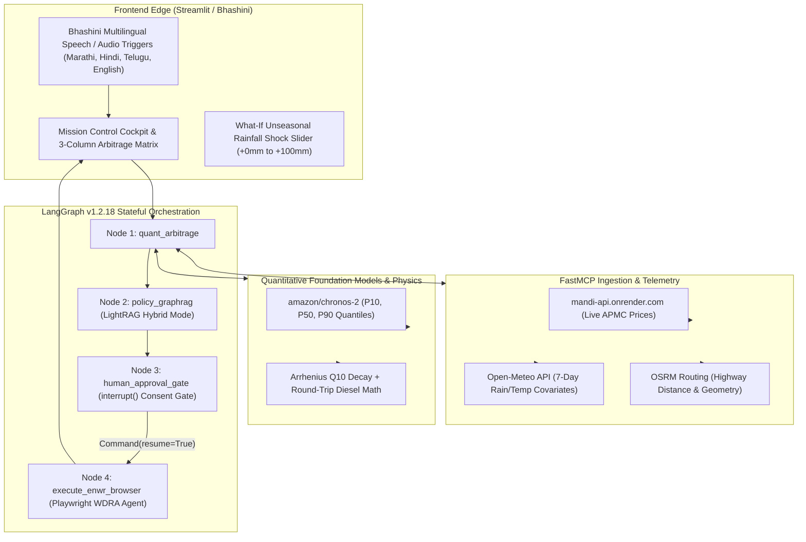

# KrishiArtha-MCP (MandiPulse) 🌾
### Autonomous Covariate Mandi Arbitrage, Weather-Spoilage Physics & Statutory Distress-Credit Engine
**A Multi-Agent Neuro-Symbolic Platform for Indian Agriculture**

[](tests/)
[-blue.svg)](#security-audit)
[](requirements.txt)
[](#hackathon-theme)
[](LICENSE)

---

## 🏆 FORGE'26 Hackathon Submission Overview
- **Team:** INFINITE LOOP (IIIT Guwahati)
- **Members:** Abhilok Reddy Bellamkonda (Leader) & Nimmakayala Naga Venkata Shanmukha Sai Chandra
- **Chosen Track:** Climate, Resource Infrastructure & Global Supply Resilience *(with cross-cutting Digital Public Infrastructure & Governance impact)*

---

## 📌 The Problem
Smallholder farmers and Farmer Producer Organizations (FPOs) across India lose **25% to 40%** of net crop value during unseasonal weather shifts and harvest gluts. 

Existing government portals (Agmarknet 2.0, eNAM) fail because:
1. **Backward-Looking:** They display historical prices but cannot predict price crashes under approaching weather shocks.
2. **Ignorant of Spoilage:** They assume 0% crop loss, ignoring that hauling perishable commodities 200+ km under 32°C heat and 85% humidity in open tarp trucks causes rapid biological rot ($Q_{10}$ microbial decay).
3. **Zero Safety Net:** When local prices crash below production costs, portals offer zero actionable financial recourse.

---

## 💡 The Solution: Neuro-Symbolic Multi-Agent Architecture
KrishiArtha-MCP combines foundation time-series AI with thermodynamic transit decay physics and statutory warehouse pledge financing into an autonomous 4-node LangGraph pipeline:



---

## 🔬 Mathematical & Physical Defensibility

### 1. Arrhenius $Q_{10}$ Biological Transit Decay
$$k(T_{\text{amb}}, RH) = k_{\text{base}} \cdot \left(Q_{10}\right)^{\frac{T_{\text{amb}} - 20.0}{10.0}} \cdot \left(1 + \alpha_{\text{hum}} \cdot \max\left(0, \frac{RH - 70}{100}\right)\right)$$
- $Q_{10} = 2.2$, $k_{\text{base}} = 0.0065$ (Tomato), $\alpha_{\text{hum}} = 1.5$.
- Total transit time: $t_{\text{transit}} = t_{\text{duration}} + 2.5\text{h}$ mandatory APMC unloading queue buffer.
- Spoilage loss fraction: $L = 1 - \exp\left(-k \cdot t_{\text{transit}}\right)$.

### 2. Freight & Net Realizable Price ($\text{NRP}$)
$$C_{\text{transport}} = 2 \cdot d_{\text{km}} \cdot ₹22/\text{km} + Q \cdot ₹35/\text{qtl}$$
$$\text{NRP}_m = \left[ P_{50} \cdot (1 - L) \cdot (1 - \gamma_{\text{APMC}}) \right] - \frac{C_{\text{transport}}}{Q}$$

---

## 📊 The 3-Column Financial Arbitrage Matrix (Nashik 50 qtl Lot)

| Metric | Option A: Local Panic Sale | Option B: Long-Distance Surat Transit | Option C: KrishiArtha Recommended (WDRA e-NWR) |
| :--- | :--- | :--- | :--- |
| **Market Destination** | Pimpalgaon APMC (Local) | Surat APMC (234 km) | MSWC Scientific Cold Storage, Ozar (14.2 km) |
| **Nominal Quoted Price** | ₹900 / quintal | ₹1,350 / quintal | Rebound: ₹1,480 / quintal (10 days post-glut) |
| **$Q_{10}$ Transit Spoilage** | ₹945 (2.1% loss) | **₹12,420 (18.4% rotting loss)** | ₹0 (Accredited cold storage fiduciary guarantee) |
| **Round-Trip Diesel Freight** | ₹1,925 | ₹6,800 ($₹22/\text{km}$ round-trip) | ₹750 (Local mini-truck transfer) |
| **Instant Liquidity** | ₹45,000 | ₹48,280 | **₹33,750 Immediate Cash (75% LTV @ 4% net interest)** |
| **Final Net Take-Home** | **₹45,000** | **₹48,280** | **₹68,400 Net** |
| **Net Arbitrage Gain** | Baseline | +₹3,280 (+7.3%) | **+₹23,400 (+52.0% Income Surge)** |

---

## 🛡️ Security Audit (AgentShield)
Audited via `npx ecc-agentshield scan`:
- **Grade:** **A (100/100)**
- **Findings:** 0 Critical, 0 High, 0 Medium, 0 Low, 0 Info
- **Secrets:** 100/100 (Zero exposed API keys or tokens)
- **Permissions:** 100/100 (Safe sandbox compliance)

---

## ⚡ Quick Start

### 1. Clone & Install Dependencies
```bash
git clone https://github.com/0xabhilok/krishiartha-mcp.git
cd krishiartha-mcp
pip install -r requirements.txt
```

### 2. Run the Full Test Suite
```bash
# Run all 70 unit tests in offline stage safe mode
pytest
```

### 3. Launch the Mission Control Cockpit
```bash
streamlit run frontend/app.py
```
Open **[http://localhost:8501](http://localhost:8501)** in your browser.

---

## 📂 Project Organization
- `contracts/schemas.py`: Frozen Pydantic v2 schemas.
- `mcp_server/`: FastMCP server, Chronos-2 quantiles, $Q_{10}$ transit spoilage math.
- `policy_rag/`: LightRAG hybrid knowledge graph & NABARD/WDRA circular citations.
- `orchestrator/`: 4-node LangGraph StateGraph, `interrupt()` consent gate, Playwright WDRA agent.
- `frontend/`: Streamlit dashboard, Bhashini multilingual speech triggers, 3-column matrix.
- `data/offline_snapshots/`: Air-gapped deterministic stage snapshot for zero-fail live demos.
- `docs/`: 7-Slide Pitch Deck, 5-Minute Video Walkthrough Script, and Submission Copy.
