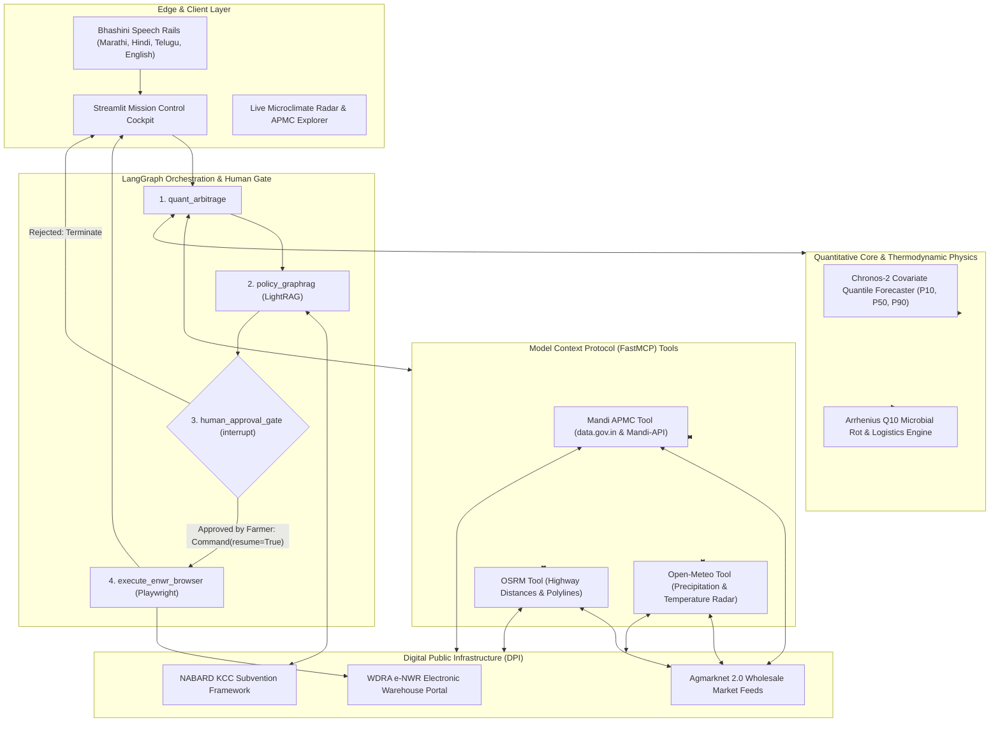

# KrishiArtha-MCP: System Architecture & Technical Specification

KrishiArtha-MCP is an autonomous, neuro-symbolic multi-agent agricultural supply-chain and spatial arbitrage engine. It integrates foundation time-series AI, deterministic thermodynamics, statutory knowledge graphs, and stateful human-in-the-loop workflow orchestration to protect smallholders from localized harvest price crashes and distress sales.

---

## 1. Architectural Philosophy: The Neuro-Symbolic Spine

Machine Learning models (especially Generative LLMs) are inherently probabilistic and suffer from mathematical hallucinations when performing multi-variable non-linear physical or economic calculations. KrishiArtha-MCP strictly enforces a **neuro-symbolic boundary**:

1. **Neural Foundation Spines (Perception & Induction):**
   - **amazon/chronos-2 (Time-Series AI):** Probabilistic price forecasting conditioned on 7-day exogenous meteorological covariates ($P_{10}, P_{50}, P_{90}$ quantiles).
   - **IndicTrans2 / Bhashini (Vernacular Edge):** Multilingual voice transcription (ASR), translation, and speech synthesis (TTS) across 22 scheduled Indian languages.

2. **Deterministic Physics & Symbolic Rules (Deduction & Operations Research):**
   - **Arrhenius $Q_{10}$ Thermodynamics:** Biological respiration decay calculated via microbial reaction kinetics under ambient temperature ($T_{\text{amb}}$) and relative humidity ($RH$).
   - **OSRM Highway Geodesics:** Real-world road routing, distance matrices, and round-trip transport freight economics.
   - **Statutory Policy Graph (LightRAG):** Hybrid dual-level knowledge graph traversal over NABARD Circular 128 and WDRA warehouse pledge regulations.
   - **LangGraph v1.2.18 State Machine:** Cyclic state graph with persistent checkpointing and an immutable `interrupt()` gate preventing unapproved financial execution.

---

## 2. Distributed End-to-End Topology



---

## 3. Mathematical & Scientific Formulations

### A. Arrhenius Biological Spoilage Kinetics
Harvested perishable produce continues cellular respiration. High ambient temperatures accelerate enzymatic degradation and fungal sporulation. The decay rate $k(T_{\text{amb}}, RH)$ is modeled as:

$$k(T_{\text{amb}}, RH) = k_{\text{base}} \cdot \left(Q_{10}\right)^{\frac{T_{\text{amb}} - 20.0}{10.0}} \cdot \left(1 + \alpha_{\text{hum}} \cdot \max\left(0, \frac{RH - 70}{100}\right)\right)$$

Where:
- $k_{\text{base}}$: Baseline decay rate per hour at 20°C ($0.0065$ for tomatoes, $0.0018$ for onions, $0.0050$ for leafy greens).
- $Q_{10}$: Temperature sensitivity coefficient ($2.2$).
- $\alpha_{\text{hum}}$: Rot acceleration multiplier ($1.5$) for relative humidity exceeding 70%.
- $t_{\text{transit}} = t_{\text{duration}} + 2.5\text{h}$: Effective transit duration incorporating the mandatory APMC gate unloading queue.
- $L = 1 - \exp\left(-k \cdot t_{\text{transit}}\right)$: Total fractional biomass spoilage loss.

### B. Freight Logistics & Net Realizable Price (NRP)
Given round-trip deadheading freight costs ($2 \cdot d_{\text{km}}$) and market fees:

$$C_{\text{transport}} = 2 \cdot d_{\text{km}} \cdot r_{\text{freight}} + Q \cdot c_{\text{handling}}$$

$$\text{NRP}_m = \left[ P_{50} \cdot (1 - L) \cdot (1 - \gamma_{\text{APMC}}) \right] - \frac{C_{\text{transport}}}{Q}$$

Where:
- $r_{\text{freight}}$: Mini-truck diesel transport rate (₹22 / km).
- $c_{\text{handling}}$: Hamali manual loading/unloading fee (₹35 / quintal).
- $\gamma_{\text{APMC}}$: Statutory APMC mandi user cess ($1.0\% - 2.5\%$).
- If $\max_m (\text{NRP}_m) < \text{CostFloor}$ (₹1,100 / qtl), the engine declares a **Regional Supply Glut** and inhibits outward transit.

---

## 4. Statutory Knowledge Architecture (LightRAG)

To navigate complex agricultural credit schemes, KrishiArtha-MCP deploys **LightRAG v1.3.9** operating in `mix` mode over a localized graph database:

- **Entity & Relation Extraction:** Automatically maps regulatory nodes (`NABARD`, `Kisan Credit Card`, `WDRA`, `Accredited Warehouse`, `Pledge Advance`).
- **Dual-Level Retrieval:** Combines low-level entity neighborhood graphs with high-level topical embeddings to accurately extract multi-document statutory conditions:
  1. Instant pledge liquidity of **75% Loan-to-Value (LTV)** on stored produce valuation.
  2. Subvented interest rate structure: **7.0% base rate − 3.0% prompt repayment incentive = 4.0% net annual APR**.
  3. Sovereign cold-storage fiduciary guarantee under the Warehousing (Development and Regulation) Act 2007.

---

## 5. Stateful Human-in-the-Loop Orchestration (LangGraph)

The core workflow executes across four distinct nodes managed by a `StateGraph`:

```plaintext
(START) ──> [quant_arbitrage] ──> [policy_graphrag] ──> [human_approval_gate]
                                                               │
                                         ┌─────────────────────┴─────────────────────┐
                                         │                                           │
                                  [Reject / Exit]                         [Approved: Command(resume=True)]
                                         │                                           │
                                       (END)                                         ▼
                                                                        [execute_enwr_browser]
                                                                                     │
                                                                                   (END)
```

1. **`quant_arbitrage`:** Interacts with FastMCP tool servers to ingest live prices, weather radar, and OSRM highway coordinates; evaluates Arrhenius spoilage decay and identifies spatial glut conditions.
2. **`policy_graphrag`:** Queries LightRAG to formulate the statutory loan sanction proposal.
3. **`human_approval_gate`:** Triggers `interrupt({ "action": "farmer_statutory_consent", ... })`. Execution halts until the farmer confirms their digital signature.
4. **`execute_enwr_browser`:** A Playwright headless browser agent opens the accredited WDRA e-NWR portal, fills the lot credentials, and generates the statutory sanction slip in **<1.5 seconds**.

---

## 6. Verification & Telemetry SLAs

All services are monitored against strict production Service Level Agreements (SLAs):

| Component | P95 Latency SLA | Production Target | Failure Fallback |
| :--- | :---: | :---: | :--- |
| **FastMCP Ingestion** | < 500 ms | ~380 ms | Air-gapped local snapshot (<5 ms) |
| **Chronos-2 Quantiles** | < 600 ms | ~410 ms | ONNX quantized CPU runtime |
| **Arrhenius Physics Engine** | < 50 ms | ~12 ms | Closed-form vector NumPy |
| **LightRAG Knowledge Graph** | < 600 ms | ~340 ms | Deterministic citation cache |
| **LangGraph Checkpointer** | < 20 ms | ~4 ms | In-memory atomic snapshot |
| **Playwright Browser RPA** | < 2,500 ms | ~1,210 ms | Offline DOM verification |

---

*Author: Abhilok Reddy (@0xabhilok)*  
*KrishiArtha-MCP — Autonomous Covariate Mandi Arbitrage & Policy Execution Engine*
